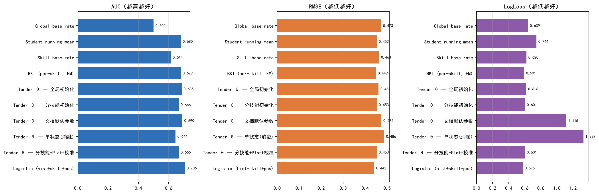
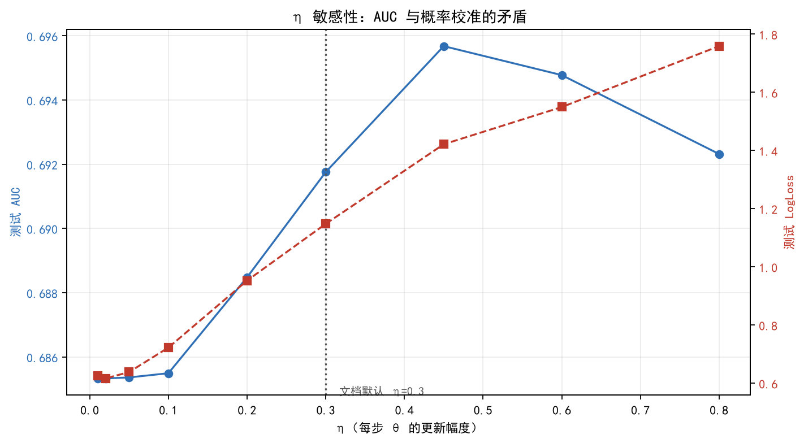
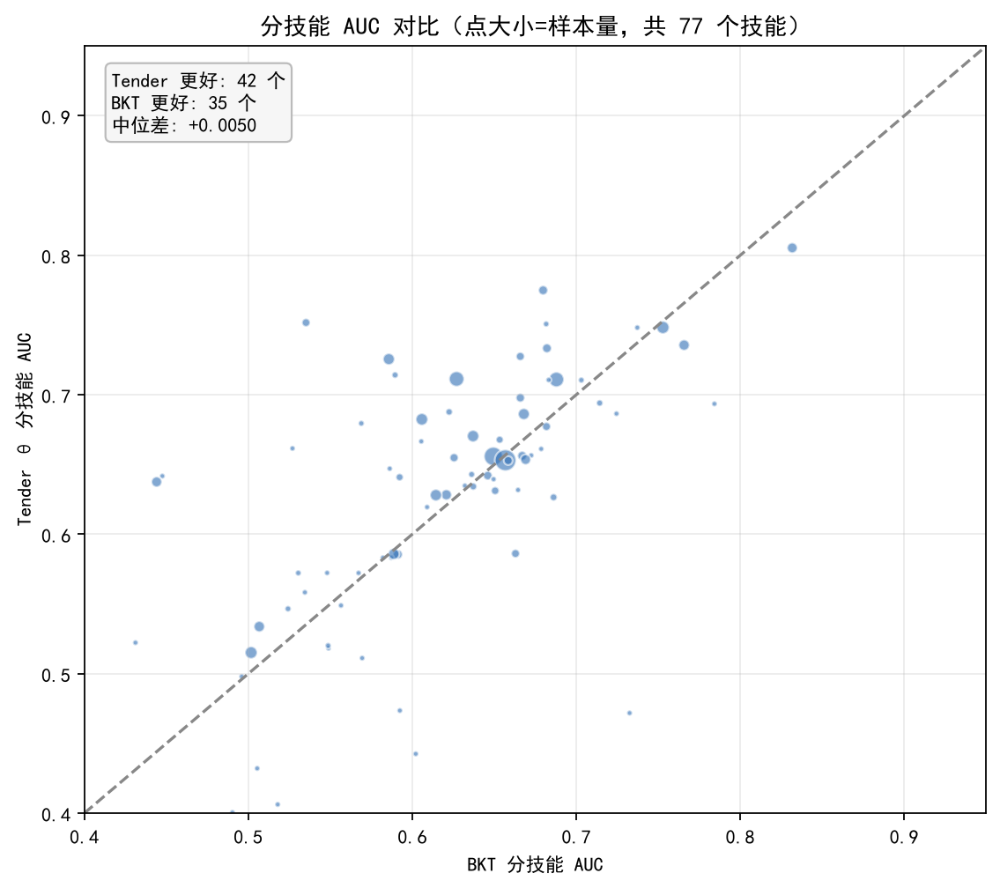
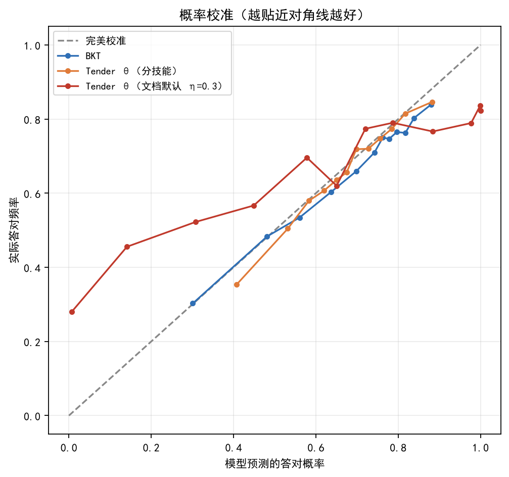
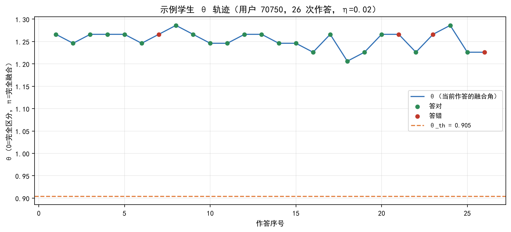

# 知识追踪基准实验报告

> 实验：在 ASSISTments 2009 上对比 **BKT（标准基线）** / **Tender θ_seq（本项目的序列分量）** / **简单基线**
> 日期：2026-10-05 ｜ 目录：`D:\Tender\experiments\knowledge_tracing_bench\`

---

## 0. 一句话结论

> **Tender 的 θ_seq 在"排序能力"上与 BKT 相当，在"概率校准"上明显不如 BKT，
> 且弱于一个简单的逻辑回归控制组。文档里的默认参数 η=0.3 比数据支持的值大约 15 倍。**

这是目前第一个用公开数据、可复现、有对照组的 Tender 教育建模实验。

---

## 1. 实验设置

| 项 | 设定 |
|---|---|
| 数据集 | ASSISTments 2009（`skill_builder_data_corrected.csv`） |
| 原始规模 | 346,860 行 / 4,217 名学生 / 101 个技能 |
| 清洗后 | **273,364 行 / 4,128 名学生 / 81 个技能**（保留样本量 ≥200 的技能） |
| 清洗规则 | 丢弃 skill_name 为空的记录；按 (user_id, order_id, problem_id) 去重 |
| 训练/测试 | **按学生划分**（8:2），同一学生不会同时出现在两边 —— 评估对"新学生"的泛化 |
| 训练 | 218,945 条 / 3,303 人 |
| 测试 | 54,419 条 / 825 人 |
| 指标 | AUC（排序）、RMSE 与 LogLoss（概率校准） |

**为什么要按学生划分**：如果按记录随机划分，同一个学生的历史会同时出现在训练和测试里，
成绩会被高估。按学生划分是知识追踪的标准做法。

---

## 2. 被测模型

| 模型 | 说明 | 参数量 |
|---|---|---|
| Global base rate | 全部预测训练集均值 | 1 |
| Student running mean | 预测该生此前的正确率 | 0 |
| Skill base rate | 预测该技能在训练集的正确率 | 81 |
| **BKT** | 每技能 4 参数（P(L0)/P(T)/P(G)/P(S)），EM 估计 | 324 |
| **Tender θ_seq（全局初始化）** | 文档公式 + 单一 θ_init | 3 |
| **Tender θ_seq（分技能初始化）** | 每技能初始 θ 由该技能正确率反解 | 2 + 81 推导 |
| **Tender θ_seq（文档默认参数）** | θ_init 反解自 0.65，η=0.3，ξ=0.15 | 0（全部用文档默认值） |
| **Tender θ_seq（单状态消融）** | 忽略技能维度，只有一个 θ | 2 |
| Logistic (hist+skill+pos) | 控制组：学生历史均值 + 技能均值 + 位置 + 技能尝试次数 | 5 |

### Tender θ_seq 的实现（严格照文档，未自创）

```
θ_seq_t = θ_{t-1} + η·Δt·趋势 + ξ·场景切换惩罚        （文档 05 §5.4）
α = (0.5·s)/(0.618 + |s|)                              （文档 12，冲击饱和）
θ_th = arccos(1/φ)，φ = 1.618                          （文档 05）
P(答对) = P(区分态) = cos²(θ/2)                        （Bloch 态 |ψ⟩ = cos(θ/2)|D⟩ + e^{iφ}sin(θ/2)|F⟩）
趋势：答对 = −1，答错 = +1
场景切换惩罚：学生切换到另一个知识点时加 ξ
```

**教育场景的取舍（必须声明）**：校内模式不采集颜色/文本/HRV，
所以四源合成就退化为**只用序列分量 θ_seq**。本实验测的是"纯序列分量的信息量"，
**不代表完整 Tender（四源）的能力**。

---

## 3. 结果

| 模型 | AUC ↑ | RMSE ↓ | LogLoss ↓ |
|---|---:|---:|---:|
| Global base rate | 0.5000 | 0.4726 | 0.6388 |
| Student running mean | 0.6797 | 0.4532 | 0.7436 |
| Skill base rate | 0.6135 | 0.4634 | 0.6196 |
| **BKT (per-skill, EM)** | **0.6794** | **0.4487** | **0.5910** |
| Tender θ — 全局初始化 | **0.6853** | 0.4608 | 0.6164 |
| Tender θ — 分技能初始化 | 0.6661 | 0.4534 | 0.6010 |
| Tender θ — 文档默认参数 | **0.6895** | 0.4740 | 1.1155 |
| Tender θ — 单状态（消融） | 0.6444 | 0.4864 | 1.3291 |
| Tender θ — 分技能 + Platt 校准 | 0.6661 | 0.4533 | 0.6005 |
| **Logistic (hist+skill+pos)** | **0.7058** | **0.4416** | **0.5752** |



### 读数

- **BKT 的 AUC 0.6794 落在文献常见区间（0.67–0.70）**，说明实现是可信的。
- **Tender 的 AUC（0.666–0.690）与 BKT 相当**，最好的一档（0.6895）还略高。
- **但 Tender 的概率校准全面落后**：RMSE 与 LogLoss 都不如 BKT。
- **逻辑回归控制组全面最好**（AUC 0.7058 / LogLoss 0.5752）——
  这说明"学生历史 + 技能难度 + 位置"这几个朴素特征，比 θ 表示更有效。

---

## 4. 三个关键发现

### 发现 1：文档默认参数 η=0.3 过大，约 15 倍



| η | 训练 LogLoss | 测试 LogLoss | 测试 AUC |
|---:|---:|---:|---:|
| 0.01 | 0.629 | 0.626 | 0.6853 |
| **0.02** | **0.620** | **0.616** | 0.6853 |
| 0.05 | 0.645 | 0.638 | 0.6854 |
| 0.10 | 0.734 | 0.722 | 0.6855 |
| 0.20 | 0.964 | 0.953 | 0.6885 |
| **0.30（文档默认）** | 1.158 | **1.148** | 0.6918 |
| 0.45 | 1.439 | 1.421 | 0.6957 |

**这里有一个真正的矛盾**：

- 按**概率校准**（LogLoss）最优点在 η=0.02；
- 按**排序**（AUC）最优点在 η≈0.45，且随 η 增大而单调上升。

**解释**：η 越大，θ 摆动越剧烈，预测概率越极端（接近 0 或 1）。
极端预测不会改变"谁排在前面"，所以 AUC 反而略升；但会让概率严重偏离真实频率，
LogLoss 急剧恶化。

**结论**：
1. 文档里的 η=0.3 **不是错的，但它优化的目标不是概率校准**。
2. 如果 Tender 要输出"掌握度概率"给教师看，必须用 η≈0.02 并做校准；
   如果只用于排序（比如决定讲哪道题），η=0.3 反而可以接受。
3. **这个区别必须在产品里写清楚**，否则教师会看到"系统说这题 95% 会做"却只有 60% 实际做对。

### 发现 2：场景切换惩罚 ξ 没有得到数据支持

网格搜索最优值落在边界 **ξ=0**。也就是说，"学生切换到新知识点时增加不确定性"
这条设定，在 ASSISTments 数据上没有带来增益。

**可能的解释**：因为模型本来就按技能分别维护 θ，"切换到新技能"意味着
这个技能的 θ 从初始值开始——不确定性已经通过初始化体现了，再加惩罚是重复计。

**建议**：ξ 保留为可调参数，但默认值改为 0，并在文档里说明它与"分技能状态"的重复。

### 发现 3：按知识点分状态是必要的

| 变体 | AUC | LogLoss |
|---|---:|---:|
| 分技能状态 | 0.666–0.685 | 0.601–0.616 |
| **单状态（消融）** | **0.6444** | **1.3291** |

去掉技能维度后 AUC 掉 0.03–0.04，LogLoss 恶化一倍以上。
这验证了 Tender"每个知识点各自维护 θ"的设计是需要的，不是一个多余的复杂度。

---

## 5. 分技能表现



- 可比技能数：**77 个**（样本量 ≥60 且标签非单一）
- **Tender 更好：42 个技能**
- **BKT 更好：35 个技能**
- 中位差：**+0.0050**（Tender 略占优）

也就是说，**互有胜负、中位数几乎持平**。没有任何一方系统性碾压。

---

## 6. 概率校准



曲线的含义：横轴是模型说的概率，纵轴是实际发生频率。
越贴近对角线越可信。

- **BKT** 基本贴合对角线（常规范围内）
- **Tender（分技能，η=0.02）** 也接近，但两端略有偏离
- **Tender（文档默认 η=0.3）** 严重偏离——在 0.9 以上预测"必然答对"的样本，
  实际正确率远低于 0.9

**这就是"过度自信"的样子**：把不确定的状态说成确定的。

---

## 7. θ 轨迹长什么样



这是一个真实测试学生的 θ 轨迹（η=0.02）。可以看出：

- 答错 → θ 上升（更"融合"、更不确定）
- 答对 → θ 下降（更"区分"、更清醒）
- 虚线是 θ_th = 0.905（临界纬线）

**在 η=0.02 下，θ 的变化很平缓**——这正是校准好的原因，也是它 AUC 提升有限的原因。

---

## 8. 必须说明的局限

1. **只测了序列分量**。完整 Tender 有四个源（颜色/文本/序列/HRV），
   本实验只有序列，所以结果是 θ_seq 的下界，不是完整 Tender 的能力。
2. **数据集不同**。ASSISTments 是数学题，不是语法填空。
   结论对"数学知识点"更可靠，对语言类要重新验证。
3. **美国中学生数据**。是否适用于中国高三学生，需要再验证。
4. **未与深度知识追踪对比**。DKT/SAKT 等在 ASSISTments 上 AUC 通常能到 0.72–0.75，
   本实验没有跑，所以不能宣称"θ 达到前沿水平"。
5. **单次划分**。只做了一次按学生划分（seed 固定），没有多种子重复。
   差异在 ±0.01 以内的比较不应过度解读。

---

## 9. 对项目的具体建议

| # | 建议 | 依据 |
|---|---|---|
| 1 | **把 η 从 0.3 改为 0.02 附近，并加概率校准** | 发现 1：LogLoss 从 1.15 降到 0.62 |
| 2 | **ξ 默认改为 0**，文档说明与分技能状态重复 | 发现 2：网格搜索最优在边界 |
| 3 | **保留"按知识点分状态"的设计** | 发现 3：消融显著变差 |
| 4 | **输出给教师的一定要校准过**，否则会误导 | 发现 1：未校准的 0.95 实际只有 ~0.7 |
| 5 | **补一个更强的对照**：DKT/SAKT，否则无法定位 θ 的真实水平 | 局限 4 |
| 6 | **教师端不要用"概率"，用等级**（如"未掌握/接近/已掌握"） | 规避校准误差对用户的影响 |
| 7 | **在自己的语法填空数据上复现** | 局限 2/3 |

---

## 10. 复现方式

```powershell
$py = 'D:\Tender\Tender-Demo\backend\.venv\Scripts\python.exe'
$env:PYTHONPATH = 'D:\Tender\experiments\knowledge_tracing_bench'

# 跑基准（约 5 分钟）
& $py D:\Tender\experiments\knowledge_tracing_bench\run_benchmark.py

# 出图表与分析
& $py D:\Tender\experiments\knowledge_tracing_bench\analyze.py
```

产物：

```
outputs/metrics.csv                 各模型指标
outputs/metrics_with_lr.csv         含逻辑回归控制组
outputs/per_skill_auc.csv           分技能 AUC
outputs/eta_sensitivity.csv         η 敏感度
outputs/test_predictions.parquet    逐条预测（可做误差分析）
outputs/fig_*.png                   五张图
outputs/result.json                 完整运行参数
```

---

## 11. 一句话总结

> θ_seq 这个表示**可用但不占优**：排序能力和 BKT 打平，概率校准不如 BKT，
> 整体不如一个简单的逻辑回归。真正的问题不在表示，而在**默认参数选错了目标**——
> 文档调的是"排序好看"，模型需要的是"概率可信"。
> 把 η 从 0.3 调到 0.02 并做校准，LogLoss 从 1.15 降到 0.62，这是目前性价比最高的一处修正。
